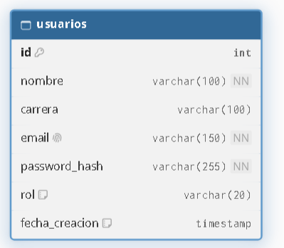

# Proyecto : VectorLab

# Descripción de la aplicación web
Nuestra aplicación web será una plataforma educativa basada en inteligencia artificial que ayudará a estudiantes de secundaria a prepararse para el ingreso a la universidad mediante la resolución y explicación detallada del área de ciencias matemáticas(física, geometría, trigonometría, etc.) preuniversitaria.

El objetivo principal no será simplemente proporcionar respuestas correctas, sino enseñar al estudiante a comprender los conceptos físicos, interpretar los enunciados y aprender a resolver problemas por su cuenta.

| Equipo | Rol | Porcentaje |
| :--- | :--- | :---: |
| Anthony Moises Condori Choccata | Desarrolladores | 100% |
| Maria Quispe Sinticala  | Desarrolladores | 100% |
|Mark Hancco Vargas | Desarrolladores | 100% |
| | **Total** | **100%** |

| Entregables | URL |
| :--- | :--- |
| Repositorio | https://github.com/Alt-Anthony/VectorLab.git |
| **Informes**[^1] | |
|lab07 |https://drive.google.com/file/d/1qutqSLW_S-WKBHDUYBBYiWIqUYEYsgig/view?usp=sharing|


# Tecnología utilizada[^2]

| Ítem | Tecnología |
| :--- | :--- |
| **Desarrollo** | GNU/Linux |
| | Git |
| | Github |
| | Vim |
| **Frontend** | HTML5 |
| | CSS3 |
| | JavaScript |
| **Backend** | NodeJS |
| | Express |
| | zod |
| **BD** | SQL |
| | Supabase |
| **Despliegue** | Docker |
| | Netlify |
| | Vercel |
| | Render |
| | Railway |


# Modelo de Datos[^3]


# Estructura del proyecto
```bash
VectorLab/
├── backend/
│   ├── config/
│   │   └── db.js                 # Conexión y pool de PostgreSQL
│   ├── controllers/              # Lógica de negocio
│   │   ├── adminController.js    # Administración de estudiantes
│   │   └── authController.js     # Autenticación y registro
│   ├── middlewares/              # Interceptores de seguridad
│   │   └── authMiddleware.js     # Verificación de sesión y roles
│   ├── models/                   # Persistencia y consultas SQL
│   │   └── users.js              # Consultas a la tabla usuarios
│   ├── routes/                   # Enrutadores Express.js
│   │   ├── auth.js               # Rutas públicas (/api/auth)
│   │   ├── estudiantes.js        # Rutas de administración (/api/estudiantes)
│   │   └── perfil.js             # Rutas protegidas (/api/perfil)
│   ├── server.js                 # Servidor principal de Express
│   ├── package.json              # Configuración y dependencias de Node.js
│   └── .gitignore
├── bd/                           # Scripts de la base de datos
│   ├── 01_estudiantes.sql        # Script DDL de esquema inicial
├── frontend/                     # Cliente Web
│   ├── priv/                     # Vistas protegidas por sesión
│   │   ├── perfil.html           # Interfaz de perfil
│   │   └── estudiantes.html      # Interfaz de administración
│   ├── pub/                      # Recursos de acceso público
│   │   ├── js/
│   │   │   └── auth.js           # Lógica cliente para autenticación
│   ├── index.html                # Página principal de entrada
├── informes/                     # Documentación y reportes del proyecto
│   ├── IDWeb_lab07_avance_proyecto.pdf
│   └── IDWeb_proyecto_informe_final.pdf
├── .gitignore
└── README.md
```

# Referencias
- https://askubuntu.com/
- https://git-scm.com/
- https://github.com/
- https://www.vim.org/
- https://neovim.io/
- https://html.spec.whatwg.org/multipage/
- https://www.w3.org/TR/2001/WD-css3-roadmap-20010523/
- https://javascript.info/
- https://supabase.com/
- https://www.docker.com/
- https://www.netlify.com/
- https://vercel.com/
- https://render.com/
- https://railway.com/

[^1]: Los informes deben estar en el repositorio del grupo en un subdirectorio llamado 'informes'.
[^2]: Se debe utilizar tecnología para frontend: HTML5, CSS3, JS nativo, flexbox, Bootstrap y para backend: NodeJS + express.
[^3]: La base de datos debe estar en la nomenclatura y estándares explicados en clase, se puede usar, MySQL, PostgreSQL o Supabase.
